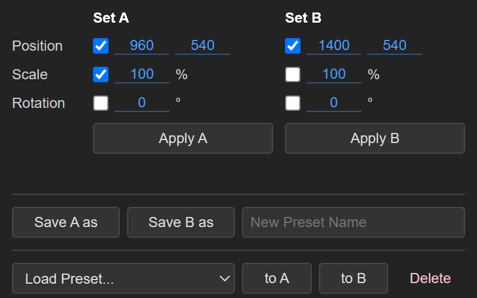

# ndr Transform Quick Apply

A small, free Adobe Premiere Pro panel that applies **Scale**, **Position** and/or **Rotation** to the selected timeline clips in one click. Keep two transform states side by side (Set A and Set B) and reuse them with named presets.

  

## Compatibility

| | |
|---|---|
| Tested on | Adobe Premiere Pro **25.5.2**, Windows 11 |
| Should load on | Premiere Pro 25.0 and later (set in `CSXS/manifest.xml`) |
| Type | CEP panel (HTML/JS + ExtendScript) |
| macOS | Not tested; see manual install below |


## How to Use

1. Select one or more clips in the timeline.
2. **Set** your Scale, Position and Rotation values.
3. **Click Apply** to apply any of the checked PSR values.
4. **Presets:** type a name and click **Save A as** or **Save B as** to store that set's ticks and values. Pick a preset from **Load Preset...** and click **to A** or **to B** to load it into that set. **Delete** removes the selected preset.

## Features

Set A and B values
- Two side-by-side PSR states, Set A and Set B, so you can quickly apply either.
- Apply button follows Tick or Unticked properties 
- Drag a value left or right to adjust it, like Premiere's own controls (hold Shift for steps of 10), or click it to type.
- Applies to every selected video clip at once; audio clips in the selection are ignored.
Preset Saving
- Save either set as a named preset (e.g. "Zoom 120 left"), load a preset into either set, delete presets.
- Remembers your last values and presets between sessions.
Keyframe Handling
- Keyframed properties are skipped and listed in the status line, so existing animation isn't overwritten.
- Changes go on Premiere's normal Edit > Undo stack.


## Install (Windows)

1. Download this repository (green **Code** button > **Download ZIP**) and unzip it.
2. In the unzipped folder, run:
   ```
   powershell -ExecutionPolicy Bypass -File install.ps1
   ```
3. Restart Premiere Pro, then open **Window > Extensions > ndr Transform Quick Apply**.

The installer copies the panel to `%APPDATA%\Adobe\CEP\extensions\ndr-transform-quick-apply` and sets `PlayerDebugMode=1` under `HKCU\Software\Adobe\CSXS.11` and `CSXS.12`. That setting is required because the panel isn't signed with an Adobe certificate; without it Premiere hides the panel.

### Manual install (Windows or macOS, untested on macOS)

1. Copy this folder (with `CSXS`, `index.html`, `main.js`, `host.jsx`) to:
   - Windows: `%APPDATA%\Adobe\CEP\extensions\ndr-transform-quick-apply`
   - macOS: `~/Library/Application Support/Adobe/CEP/extensions/ndr-transform-quick-apply`
2. Allow unsigned panels:
   - Windows: add a string value `PlayerDebugMode` = `1` under `HKEY_CURRENT_USER\Software\Adobe\CSXS.12`
   - macOS: `defaults write com.adobe.CSXS.12 PlayerDebugMode 1`
3. Restart Premiere Pro.

## Limitations

- Expects Premiere's English UI (it finds "Motion", "Scale", "Position", "Rotation" by name).
- Scale sets the uniform Scale value; if a clip has **Uniform Scale** turned off, only the height changes.
- Each property change may be its own Undo step.

## Uninstall

Delete `%APPDATA%\Adobe\CEP\extensions\ndr-transform-quick-apply` (macOS: the folder under `~/Library/Application Support/Adobe/CEP/extensions`) and restart Premiere.

## Files

| File | Purpose |
|---|---|
| `CSXS/manifest.xml` | Extension id, supported Premiere versions, panel size |
| `index.html` | Panel UI |
| `main.js` | UI logic and presets (stored in the panel's localStorage) |
| `host.jsx` | ExtendScript that changes the clips' Motion properties |
| `install.ps1` | Windows installer for the current user |

## Changelog

### v1.5
**Functional Changes:**
- Added a second transform state (Set), so Set A and Set B now sit side by side.
- Changed how values are input.
- Type-only boxes changed to Premiere Pro's default draggable left or right values. Hold Shift for steps of 10, or click a value to type.
- Either Set can also be saved as a Preset and loaded to either Set A or B.
**Logic and UI changes:**
- Moved the status message under the Apply buttons.
- Split the panel in two: the top half affects the timeline and the bottom half manages presets.

### v1.0
- First release
- Apply a fixed set of Scale, Position and Rotation to multiple selected clips
- Save set as a named preset


## License

MIT, see [LICENSE](LICENSE).
